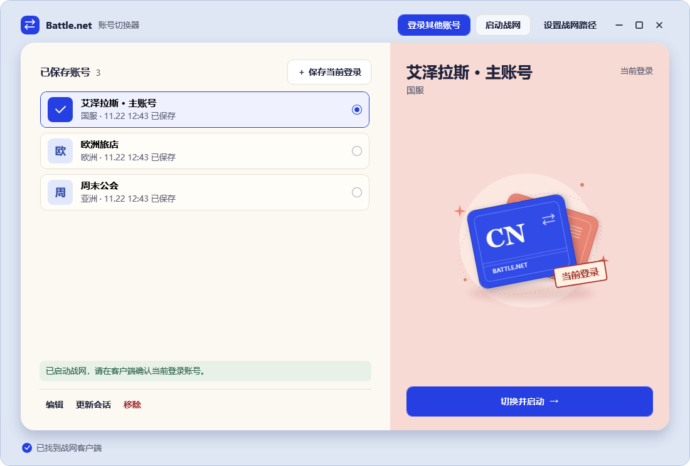

# 战网账号切换器

一个用 C#、.NET 8 和 WPF 编写的 Windows 桌面工具。它保存本机战网登录会话，让你从账号列表选择一个账号，恢复会话并启动战网。



## 功能

- 保存、切换、重命名、更新和移除账号，支持国服、美洲、欧洲和亚洲。
- 通过「登录其他账号」打开新的登录环境。已保存的账号可以从列表恢复。
- 自动查找战网启动程序，也可以手动设置路径。
- 使用当前 Windows 用户的 DPAPI 保护会话快照。启动失败时回滚本次切换。

## 使用方法

1. 在战网登录第一个账号，勾选「保持登录」。登录完成后，从 Windows 系统托盘退出战网。客户端里的「登出」可能让已保存的会话失效。
2. 在切换器中点「保存当前登录」，填写显示名称并选择地区。
3. 要添加下一个账号，点「登录其他账号」，在战网登录后从托盘退出，再保存该账号。
4. 已保存的账号可以从列表选中，然后点「切换并启动」。
5. 会话失效或显示「需更新会话」时，在战网重新登录对应账号，从托盘退出后点「更新会话」。

如果客户端要求重新登录或验证，请按战网提示操作。「当前登录」标记取自切换器的会话记录，实际登录结果以战网客户端为准。

## 从源码运行

在 Windows 上安装 .NET 8 SDK，然后在仓库根目录运行。依赖由 NuGet 还原。

```powershell
dotnet run --project src/BattleNetSwitcher/BattleNetSwitcher.csproj
```

如果切换器未找到战网，点击「设置战网路径」，选择 `Battle.net Launcher.exe` 或 `Battle.net.exe`。

## 打包 Windows x64 可执行文件

轻量版使用系统安装的 .NET 8 桌面运行时（x64）。

```powershell
dotnet publish src/BattleNetSwitcher/BattleNetSwitcher.csproj -c Release -r win-x64 --self-contained false -p:PublishSingleFile=true -p:DebugType=None -o artifacts/win-x64-light
```

独立版把 .NET 运行时打包到 EXE 中，可在未安装运行时的 Windows x64 电脑上使用。

```powershell
dotnet publish src/BattleNetSwitcher/BattleNetSwitcher.csproj -c Release -r win-x64 --self-contained true -p:RuntimeFrameworkVersion=8.0.34 -p:PublishSingleFile=true -p:IncludeNativeLibrariesForSelfExtract=true -p:EnableCompressionInSingleFile=true -p:DebugType=None -o artifacts/win-x64
```

## 会话存储与恢复

本机数据保存在 `%LOCALAPPDATA%\BattleNetSwitcher`。每份加密快照包含战网的本地目录、漫游目录和相关注册表配置。切换时会校验快照，并将数据解包到暂存目录，然后才替换当前配置并启动战网。快照使用 Windows 当前用户的 DPAPI 保护，恢复时请使用保存快照的 Windows 用户。

## 测试

冒烟测试使用临时目录、独立的测试注册表项和模拟启动器，覆盖账号保存与读取、切换与失败回滚、旧快照更新和窗口操作。

```powershell
dotnet run --project tests/Smoke/Smoke.csproj
```

## 免责声明

本工具仅供学习和个人使用，请勿用于任何违反暴雪/网易服务条款的行为。使用本工具产生的任何后果由使用者自行承担。

## 参考

会话切换原理参考 [cnbxqhdl](https://github.com/54006/cnbxqhdl)。界面风格参考 Oil UI 的 [Pinch 结账](https://ui.oiloil.org/works/checkout/)。
